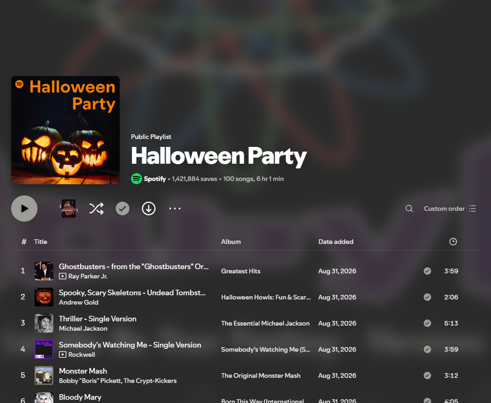

<p align="center"></p>

# AdBlockee

**An ad blocker for Spotify desktop, built for Spicetify.**

Block music ad slots, hide sponsored playlist cards and “Limited ads” labels, and remove the empty header space left behind. AdBlockee runs locally with no telemetry, tracking service or remote JavaScript loader.

[Install from Marketplace](#marketplace) · [Download](https://github.com/LennonAmos/AdBlockee-Spicetify/releases/latest) · [Report a bug](https://github.com/LennonAmos/AdBlockee-Spicetify/issues/new/choose)

## What it does

- Applies Spotify's music ad controls for audio, in-stream, billboard and embedded ads where those APIs are available.
- Disables supported music ad slots, including embedded playlists, and clears linear audio slots.
- Hides sponsor cards and labels without leaving a tall blank playlist header.
- Starts before or after Spicetify's APIs load and reapplies protection on track changes.
- Keeps cosmetic protection active when an audio API fails.
- Adds **AdBlockee status** to your profile menu for a quick compatibility check.

It does not change your subscription, catalogue, download permissions or audio quality, and cannot remove advertisements recorded into a podcast itself.



Example on Windows; the visual theme is installed separately.

## Install

Use only one ad blocker at a time. Uninstall the previous AdBlockee listing or Adblockify before enabling this version. If you used the earlier local `hide-playlist-sponsors.js` helper, disable that helper when testing these fixes so the result comes from AdBlockee alone.

### Marketplace

1. Open **Marketplace → Extensions**.
2. Set **Sort by → Newest**, then search **AdBlockee**.
3. Select the listing by **LennonAmos** linked to **LennonAmos/AdBlockee-Spicetify**, install it, and reload Spotify.

Marketplace filters cards already loaded into its grid. If Stars sorting shows no match, switch to Newest or use Load more. Initial GitHub indexing and cached results can also delay a new listing.

### Manual

Download [`adblockee.js`](https://github.com/LennonAmos/AdBlockee-Spicetify/releases/latest/download/adblockee.js) into your Spicetify Extensions folder:

| Platform | Folder |
| --- | --- |
| Windows | `%appdata%\spicetify\Extensions\` |
| Linux | `~/.config/spicetify/Extensions/` or `$XDG_CONFIG_HOME/spicetify/Extensions/` |
| macOS | `~/.config/spicetify/Extensions/` |

```sh
spicetify config extensions adblockee.js
spicetify apply
```

To uninstall a manual installation:

```sh
spicetify config extensions adblockee.js-
spicetify apply
```

## Compatibility

Spotify's ad APIs and UI selectors change frequently. Missing APIs are handled independently so one failure does not stop the remaining protection. Check **Profile → AdBlockee status** and report your Spotify version, Spicetify version and installation method if something stops working.

Windows, macOS and Linux desktop only. This repository contains no iPhone version.

Blocking advertisements is prohibited by [Spotify's User Guidelines](https://www.spotify.com/uk/legal/user-guidelines/) and may lead to account suspension or termination. A private build or independent implementation does not remove that risk.

## Development

Node.js 22 or newer:

```sh
npm ci
npm run check
```

Source lives in `src/`. `npm run build` produces the committed `adblockee.js` used by Marketplace; end users do not need Node.js. The shipped extension has no third-party runtime dependencies.

Tests cover delayed startup, API failures and timeouts, isolation of subscription properties, bounded concurrent refreshes, cleanup, valid Marketplace resources and square preview dimensions. See [validation notes](VALIDATION.md) for the live checks and their limits.

## About this version

Version 2 is a new implementation with its own lifecycle, scoped cosmetic rules, ad-manager controls and direct ad-slot configuration. It does not include the former Adblockify-derived bundle or that project's copied type declarations. The earlier version was a derivative; changing this repository does not change the history or licence of those earlier copies.

Maintained by **LennonAmos**, with Codex assistance. Released under the [MIT licence](LICENSE). Not affiliated with Spotify or Spicetify.

If AdBlockee helps you, a GitHub star makes it easier for other Marketplace users to find. Useful bug reports and reproducible fixes help keep it working.
